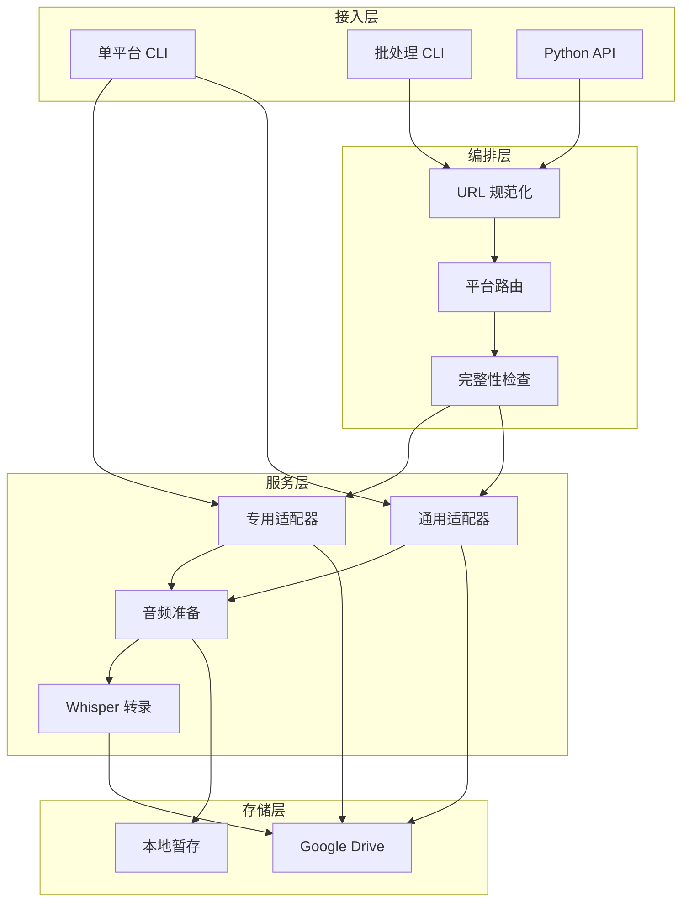
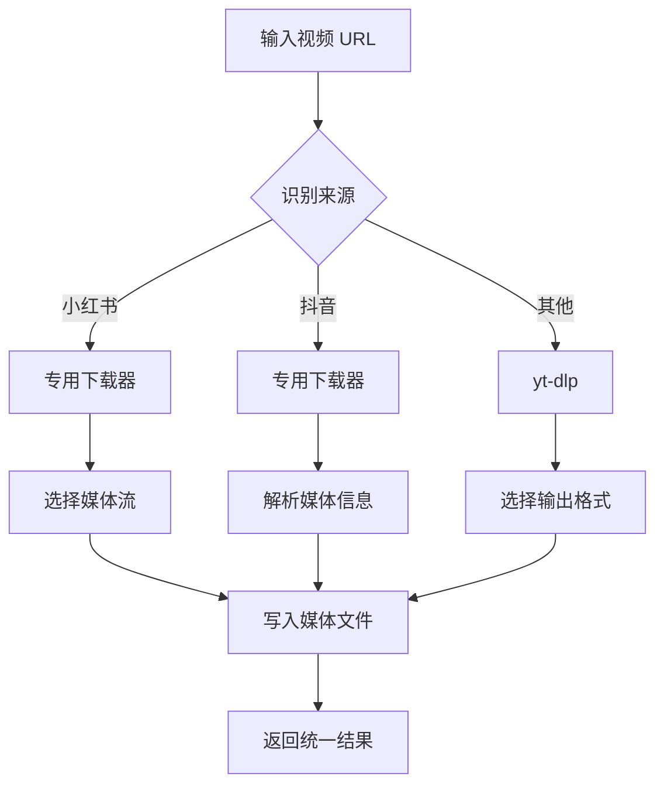
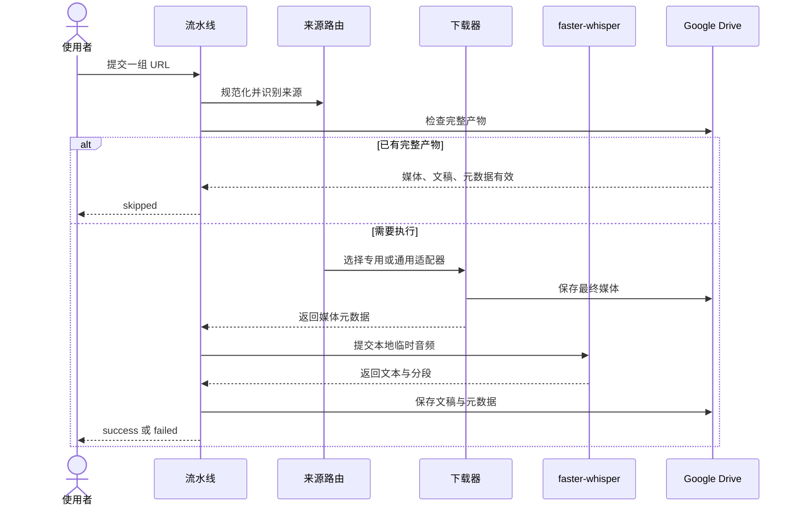

---
tags:
  - project
  - python
  - media-workflow
  - google-colab
created: 2026-07-19
---

# vedioDownload

> [!NOTE]
> 一个面向个人归档与内容整理的 Python 工具集：下载已获授权的视频，按需生成文稿，并把媒体、转录文本和结构化元数据保存到本地或 Google Drive。

**语言：** Python 3.10+<br>
**运行方式：** 本地命令行 / Python API / Google Colab<br>
**主要产物：** 媒体文件、`transcript.txt`、`metadata.json`

> [!IMPORTANT]
> 仅处理你拥有、已获授权或平台明确允许保存的内容。请遵守内容版权、隐私要求、平台服务条款及所在地法律；不要尝试访问受限、付费、私密或受 DRM 保护的内容。

---

## 整体架构



> [!TIP]
> 流水线用稳定任务 ID 组织输出。重复运行时，只有媒体、文稿和元数据三者都有效才会跳过；不完整任务会重新执行，适合应对 Colab 中断。

---

## 目录结构

```text
vedioDownload/
├── xhs_downloader.py          # 小红书专用下载入口
├── douyin_downloader.py       # 抖音专用下载入口
├── yt_dlp_downloader.py       # yt-dlp 通用下载入口
├── xhs_colab_pipeline.py      # 多平台下载、转录与 Drive 编排
├── requirements.txt           # 本地下载依赖
├── requirements-colab.txt     # Colab 转录依赖
├── requirements-dev.txt       # 测试依赖
└── tests/                     # 下载器与流水线单元测试
```

---

## 技术栈速查

| 层级 | 技术 | 版本要求 | 用途 |
| --- | --- | --- | --- |
| 运行时 | Python | 3.10+ | 命令行、平台路由与流水线 |
| 网络 | Requests | 2.31.0+ | 页面与媒体请求 |
| 进度 | tqdm | 4.66.0+ | 下载进度展示 |
| 通用下载 | yt-dlp | 2024.1.1+ | 处理其当前支持的公开媒体页面 |
| 转录 | faster-whisper | 1.1.0+ | Colab 或可选本地语音转文字 |
| 媒体处理 | FFmpeg / ffprobe | 系统命令 | 合并音视频、提取转录音频 |
| 测试 | pytest | 8.0.0+ | 自动化验证 |

`faster-whisper` 只放在 `requirements-colab.txt` 中，因此本地只下载媒体时不需要安装模型依赖。

---

## 核心特点

| 特点 | 说明 |
| --- | --- |
| 自动平台路由 | 小红书、抖音走专用适配器，TikTok 与其他链接走 yt-dlp |
| 视频与音频模式 | 通用下载器默认输出视频，也可单独提取 MP3 |
| 批量失败隔离 | 一条 URL 失败不会中断其余任务，最终逐条返回状态与错误 |
| 可恢复执行 | 小红书媒体支持断点续传；完整 Drive 产物默认跳过 |
| GPU/CPU 自适应 | 有 CUDA 时使用 `cuda + float16`，否则回退 `cpu + int8` |
| 可控转录 | 支持模型、语言、beam size、VAD 与词级时间戳参数 |
| 结构化归档 | 每条任务保存媒体、纯文本文稿和完整 JSON 元数据 |
| 凭据不落库 | 可选会话信息只在运行时传入，临时文件使用后清理 |

---

## 下载能力

### 来源路由

| 来源 | 下载实现 | 最终媒体 | 会话信息 | 说明 |
| --- | --- | --- | --- | --- |
| 小红书 / `xhslink.com` | `xhs_downloader.py` | MP4 | 可选、仅运行时 | 支持编码偏好、画质索引与媒体断点续传 |
| 抖音 | `douyin_downloader.py` | MP4 | 自动初始化匿名访客会话 | 无需手动提供 Cookie，使用同一会话解析分享页并下载公开媒体 |
| TikTok | `yt_dlp_downloader.py` | MP4 | 不混用其他来源信息 | 使用稳定视频 ID 或 URL 摘要作为任务 ID |
| 其他来源 | `yt_dlp_downloader.py` | 通常为 MP4 | 取决于来源 | 实际能力取决于当前 yt-dlp 版本和目标页面可访问性 |

### 单平台下载流程



所有下载器都返回统一的 `VideoDownloadResult`，因此上层流水线不需要理解各来源的内部差异。

---

## 转录与归档

`xhs_colab_pipeline.py` 把下载、音频准备、faster-whisper 转录和 Drive 保存串成一条工作流：

| 阶段 | 行为 |
| --- | --- |
| 任务识别 | 规范化 URL，识别平台并生成稳定任务 ID |
| 完整性检查 | 校验已有媒体非空、文稿非空、元数据与文稿一致 |
| 媒体下载 | 最终媒体直接写入目标任务目录 |
| 音频准备 | 专用来源从视频提取 WAV；通用来源单独提取临时 MP3 |
| 语音转录 | 自动选择 GPU/CPU，也可指定语言和模型 |
| 结果保存 | 写入 `transcript.txt` 与 `metadata.json` |
| 临时清理 | 转录成功后删除本地临时音频 |

默认输出布局：

```text
/content/drive/MyDrive/xhs_outputs/
└── <task_id>/
    ├── <media-file>.<ext>
    ├── transcript.txt
    └── metadata.json
```

临时音频位于 `/content/xhs_workspace/<task_id>/`。两个根目录都可以通过参数替换；虽然默认 Drive 目录沿用了 `xhs_outputs` 名称，但它可以保存全部支持来源的结果。

---

## 核心数据模型

### `VideoDownloadResult`

| 字段组 | 字段 | 说明 |
| --- | --- | --- |
| 任务身份 | `note_id`、`note_url`、`resolved_url` | 稳定任务 ID、原始 URL、解析后 URL |
| 文件信息 | `output_path`、`filename`、`format`、`size` | 最终文件位置、名称、格式与字节数 |
| 媒体信息 | `codec`、`audio_codec`、`width`、`height`、`fps` | 视频与音频基本属性 |
| 选择信息 | `avg_bitrate`、`quality_index` | 码率与实际选择的画质索引 |

### `WorkflowResult`

| 字段 | 类型 | 说明 |
| --- | --- | --- |
| `note_id` | `str` | 当前任务的稳定 ID |
| `note_url` | `str` | 用户输入 URL |
| `status` | `str` | `success`、`skipped` 或 `failed` |
| `video_path` | `str` | 最终媒体路径 |
| `transcript_path` | `str` | 文稿路径 |
| `metadata_path` | `str` | 元数据路径 |
| `transcript_preview` | `str` | 文稿前 120 个字符 |
| `error` | `str` | 失败原因；成功时为空 |

### `metadata.json`

| 顶层字段 | 内容 |
| --- | --- |
| `platform` | 来源类型：`xiaohongshu`、`douyin`、`tiktok` 或 `generic` |
| `note_id` | 稳定任务 ID |
| `note_url` / `resolved_url` | 原始地址与解析后地址 |
| `video` | 完整 `VideoDownloadResult` |
| `transcription` | 文稿、语言、置信度、模型、设备、精度和分段时间信息 |
| `outputs` | 任务目录、媒体、文稿和元数据的最终路径 |

---

## 核心调用链



---

## 接入方式

### 本地命令行

先安装 Python 与 FFmpeg：

```bash
git clone https://github.com/shaun17/vedioDownload.git
cd vedioDownload

python3.12 -m venv .venv
source .venv/bin/activate
python -m pip install -U pip
python -m pip install -r requirements.txt
```

FFmpeg 必须是系统命令，不是同名 Python 包：

```bash
# macOS
brew install ffmpeg

# Debian / Ubuntu
sudo apt-get update
sudo apt-get install -y ffmpeg
```

按来源选择入口；请把占位内容替换为你有权处理的 URL，并保留单引号，避免 URL 查询参数被 shell 拆分：

```bash
# 小红书：默认保存到 ./downloads，优先 HEVC，画质索引 0
python xhs_downloader.py '<已获授权的视频 URL>'

# 抖音：默认保存到 ./downloads
python douyin_downloader.py '<已获授权的视频 URL>'

# 其他 yt-dlp 支持的来源：默认下载视频
python yt_dlp_downloader.py '<已获授权的视频 URL>'

# 只提取 MP3
python yt_dlp_downloader.py '<已获授权的视频 URL>' ./downloads audio
```

### Python API

下面的例子在本地执行完整工作流，不挂载 Google Drive。完整转录需要先安装 `requirements-colab.txt`：

```python
from xhs_colab_pipeline import run_colab_workflow

results = run_colab_workflow(
    note_urls=["<已获授权的视频 URL>"],
    drive_root="./outputs",
    local_root="./workspace",
    mount_drive=False,
    language="zh",
)

for result in results:
    print(result.status, result.video_path, result.transcript_path, result.error)
```

### Google Colab

#### 1. 选择运行环境

在 Colab 中打开“运行时 → 更改运行时类型”，需要较快转录时选择可用的 GPU。代码会再次检测 CUDA；如果当前没有可用 GPU，会自动切换到 CPU。

#### 2. 克隆并安装

在第一个代码单元中运行：

```python
%cd /content
!test -d vedioDownload/.git || git clone --depth 1 https://github.com/shaun17/vedioDownload.git
%cd /content/vedioDownload
!git pull --ff-only
%pip install -q -r requirements-colab.txt
!command -v ffmpeg >/dev/null || (apt-get update -qq && apt-get install -y -qq ffmpeg)
```

#### 3. 执行批量工作流

```python
from xhs_colab_pipeline import run_colab_workflow

URLS = [
    "<已获授权的视频 URL 1>",
    "<已获授权的视频 URL 2>",
]

results = run_colab_workflow(
    note_urls=URLS,
    drive_root="/content/drive/MyDrive/xhs_outputs",
    local_root="/content/xhs_workspace",
    model_name="turbo",
    language="zh",
    beam_size=5,
    skip_existing=True,
    mount_drive=True,
)

for result in results:
    print({
        "status": result.status,
        "task_id": result.note_id,
        "media": result.video_path,
        "transcript": result.transcript_path,
        "error": result.error,
    })
```

第一次挂载 Drive 时，Colab 会要求你确认访问权限。第一条转录任务还可能需要下载所选 Whisper 模型。

#### 4. 使用文本文件批处理

`urls.txt` 每行放一条 URL：

```bash
python xhs_colab_pipeline.py \
  --url-file /content/urls.txt \
  --language zh \
  --model-name turbo
```

也可以重复使用 `--url`：

```bash
python xhs_colab_pipeline.py \
  --url '<已获授权的视频 URL 1>' \
  --url '<已获授权的视频 URL 2>' \
  --language zh
```

#### 5. 安全传入可选会话信息

仅在目标页面确实要求、且使用你自己的合法会话时才传入。推荐把 JSON 对象放进 Colab 左侧“密钥”面板，例如命名为 `MEDIA_SESSION_JSON`，再通过 Python API 读取；不要把值写进源码、命令行、Notebook 文本或输出。

```python
from google.colab import userdata

from xhs_colab_pipeline import parse_cookie_json, run_colab_workflow

runtime_cookies = parse_cookie_json(userdata.get("MEDIA_SESSION_JSON"))
results = run_colab_workflow(
    note_urls=URLS,
    cookies=runtime_cookies,
    language="zh",
)
```

README 不提供会话信息的提取、共享或访问限制规避方法。

---

## Colab 使用技巧

| 场景 | 建议 |
| --- | --- |
| 确认 GPU | 先运行 `!nvidia-smi`；以代码实际检测结果为准，不要只看运行时名称 |
| 首次试跑 | 先用一条短视频检查下载、转录与 Drive 权限，再提交整批 URL |
| 防止中断返工 | 把长列表拆成小批次并保持 `skip_existing=True`；完整任务会自动跳过 |
| 提高转录速度 | 已知语言时显式传 `language="zh"`；可将 `beam_size` 调低到 `1` |
| CPU 模式 | 改用较小模型（如 `small` 或 `base`），同时使用 `beam_size=1` |
| 控制元数据大小 | 非必要不要启用 `word_timestamps`；默认分段时间戳已写入 JSON |
| 减少临时盘压力 | 保持 `local_root` 在 `/content`；完成后的临时音频会自动删除 |
| 检查空间 | 批处理前运行 `!df -h /content /content/drive` |
| Drive 目录 | 保持按任务 ID 分目录，不要把大量文件平铺在 My Drive 根目录 |
| 分享 Notebook | 分享前清除敏感输出，或在 Notebook 设置中关闭保存单元格输出 |
| 结束 GPU 使用 | 完成后断开运行时；不需要 GPU 时切回标准运行时，减少资源额度消耗 |

Colab 的 GPU 类型、可用时长和资源额度会动态变化，不应把单次会话视为持久执行环境。详细限制见 [Google Colab FAQ](https://research.google.com/colaboratory/faq.html)。

### 快速诊断单元

```python
from pathlib import Path

from xhs_colab_pipeline import probe_cuda_available, resolve_transcription_runtime

has_cuda = probe_cuda_available()
device, compute_type = resolve_transcription_runtime(has_cuda)

print({
    "cuda_available": has_cuda,
    "device": device,
    "compute_type": compute_type,
    "drive_mounted": Path("/content/drive/MyDrive").exists(),
})
```

若 GPU 初始化报错，先核对当前 Colab CUDA 环境与 [faster-whisper GPU 要求](https://github.com/SYSTRAN/faster-whisper#gpu)；若通用下载无法合并音视频，检查系统是否存在 `ffmpeg` 与 `ffprobe`，并参考 [yt-dlp 依赖说明](https://github.com/yt-dlp/yt-dlp#dependencies)。

---

## CLI 命令速查

| 命令 | 功能 | 关键位置参数 |
| --- | --- | --- |
| `python xhs_downloader.py ...` | 小红书单视频下载 | `URL [输出目录] [hevc\|h264] [画质索引]` |
| `python douyin_downloader.py ...` | 抖音单视频下载 | `URL [输出目录]` |
| `python yt_dlp_downloader.py ...` | 通用视频或音频下载 | `URL [输出目录] [audio\|video]` |
| `python xhs_colab_pipeline.py ...` | 批量下载、转录与归档 | 使用下表的命名参数 |
| `python -m pytest -q` | 运行全部单元测试 | 需先安装 `requirements-dev.txt` |

---

## 配置参考

`xhs_colab_pipeline.py` 当前不要求环境变量，主要通过 CLI 参数或同名 Python 参数配置：

| CLI 参数 | 默认值 | 说明 |
| --- | --- | --- |
| `--url` | `[]` | 单条 URL，可重复传入 |
| `--url-file` | 无 | URL 文本文件，每行一条 |
| `--cookies-json` | 无 | 可选运行时会话 JSON；敏感场景优先使用 Python API + Colab 密钥 |
| `--drive-root` | `/content/drive/MyDrive/xhs_outputs` | 最终输出根目录 |
| `--local-root` | `/content/xhs_workspace` | 临时音频与任务工作目录 |
| `--prefer-codec` | `hevc` | 小红书来源的编码偏好 |
| `--quality-index` | `0` | 小红书来源的画质索引，`0` 表示首选画质 |
| `--model-name` | `turbo` | faster-whisper 模型名 |
| `--language` | 自动检测 | 显式指定转录语言，如 `zh` 或 `en` |
| `--beam-size` | `5` | 转录搜索宽度；降低可减少计算量 |
| `--word-timestamps` | 关闭 | 在元数据中加入词级时间戳 |
| `--disable-vad-filter` | 关闭 | 禁用默认的静音过滤 |
| `--no-skip-existing` | 关闭 | 强制重跑已有完整结果 |
| `--no-mount-drive` | 关闭 | 不调用 Colab Drive 挂载，适合本地调试 |
| `--force-remount` | 关闭 | 强制重新挂载 Google Drive |

> [!CAUTION]
> `--cookies-json` 会出现在命令文本或历史记录中，不适合长期凭据。需要会话信息时，优先通过 Colab 密钥和 Python API 传入。

---

## 本地开发与验证

```bash
python3.12 -m venv .venv
source .venv/bin/activate
python -m pip install -r requirements-dev.txt
python -m pytest -q
```

测试使用模拟响应验证解析、路由、文件写入、临时会话文件清理、批量失败隔离与完整产物跳过，不会执行真实媒体下载。

---

## 关键边界与约束

- 目标页面结构、访问策略和 yt-dlp 提取器会变化，某个来源曾经可用不代表永久可用。
- 通用视频合并、MP3 提取和流水线音频准备依赖系统级 `ffmpeg` / `ffprobe`。
- 私密、付费、受地域限制或 DRM 保护的内容不属于本项目支持范围。
- 可选会话信息具有账户权限，应只在运行时使用，不提交、不分享、不写入日志。
- Google Drive 是最终产物存储；`/content` 属于临时运行时，Colab 重启后可能丢失。
- Colab 资源不保证持续可用，长批次应依赖可恢复输出，而不是假设 Notebook 会一直在线。
- 仓库当前没有声明开源许可证；在复制、分发或二次发布代码前，请先取得仓库所有者许可。
